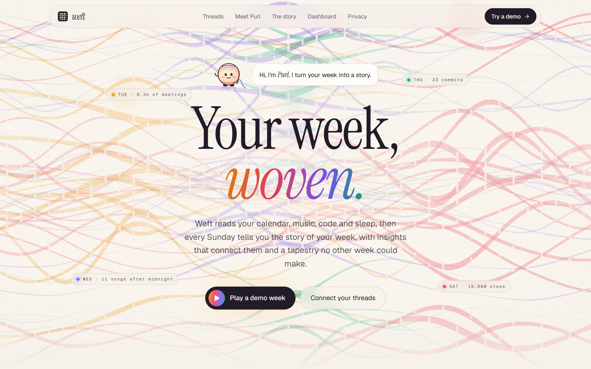
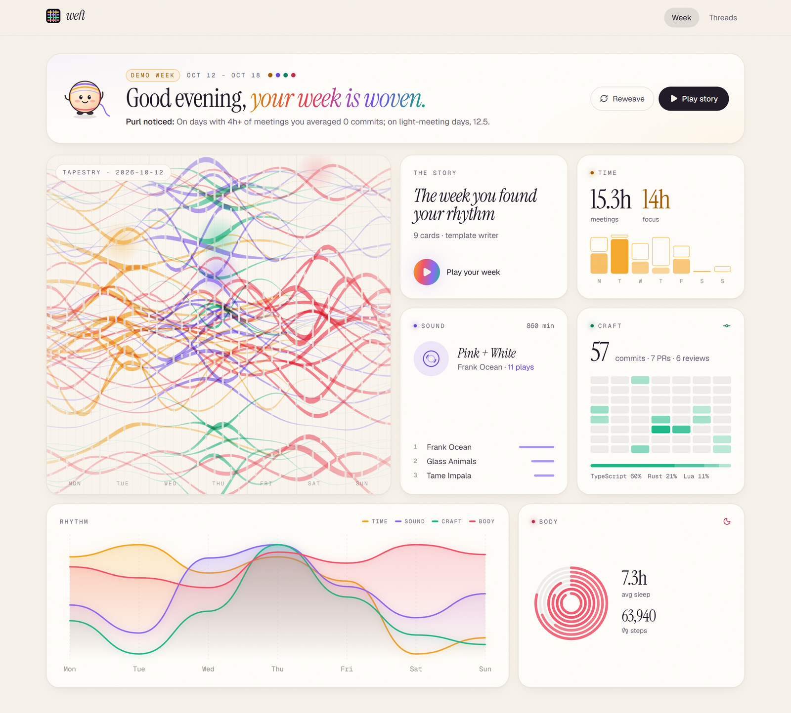
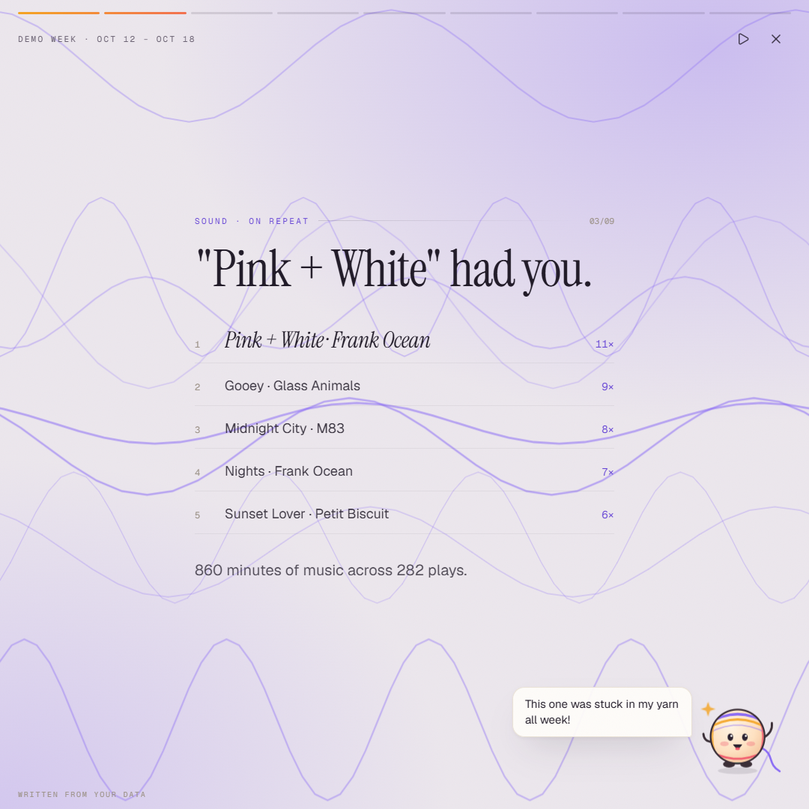
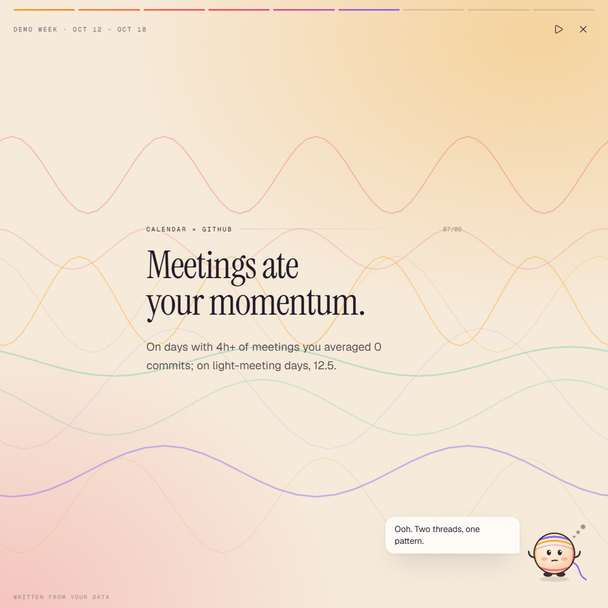
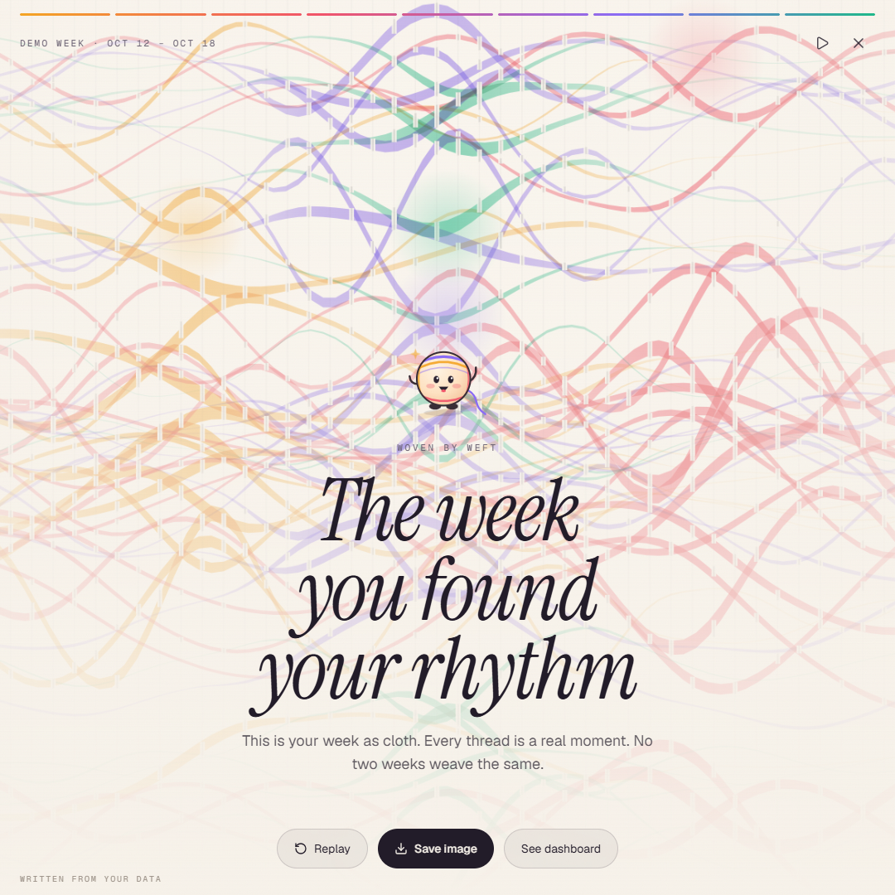
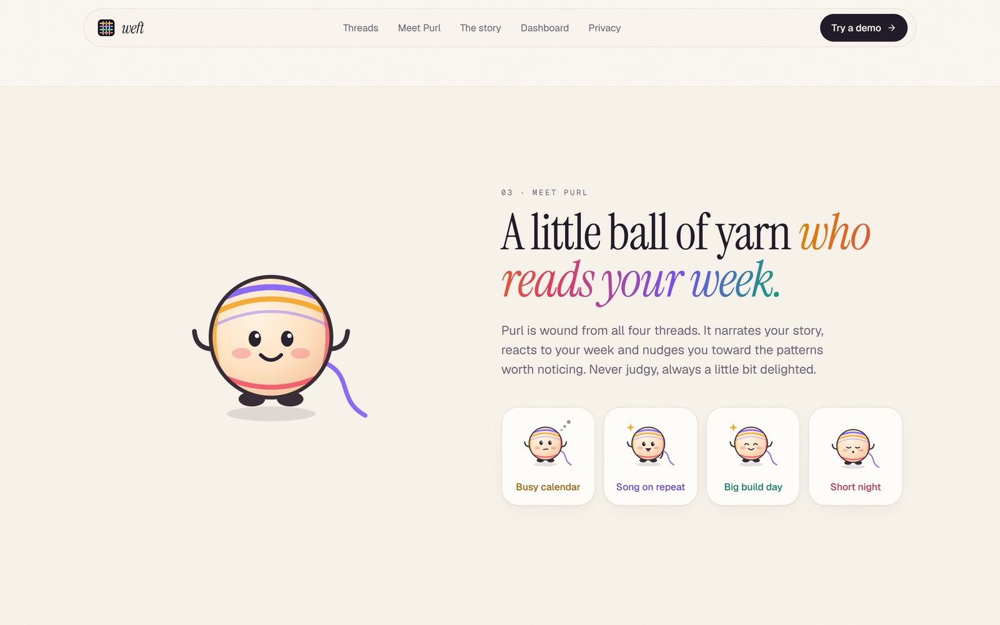
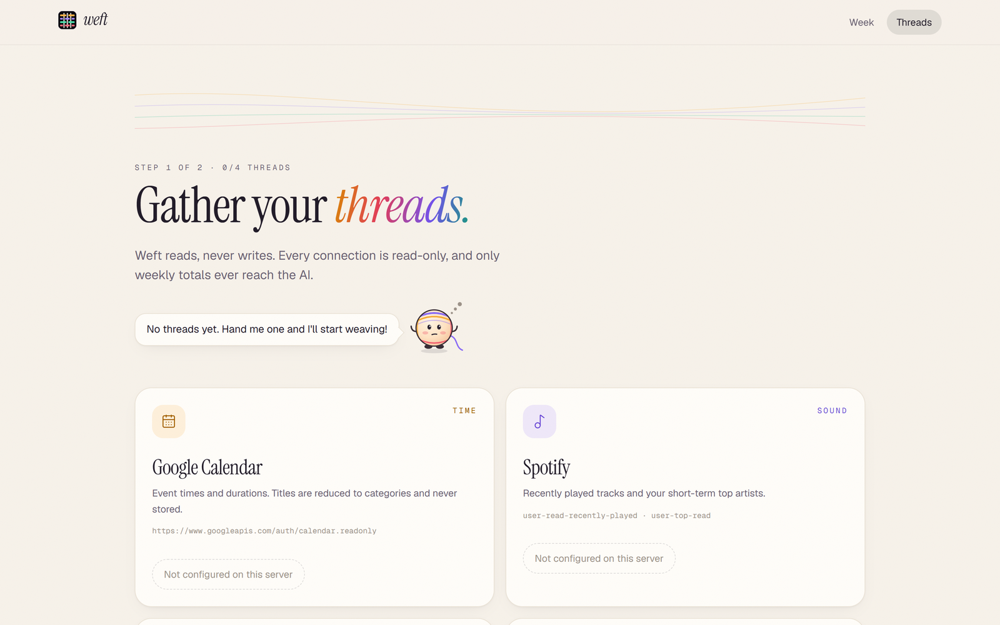

<p align="center">
  
</p>

<h1 align="center">weft — your week, woven</h1>

<p align="center">
  An AI personal life dashboard that turns your calendar, music, code and sleep into a weekly story,<br />
  narrated by <b>Purl</b>, a little ball of yarn.
</p>

<p align="center">
  <a href="docs/media/weft-launch.mp4">
    
  </a>
  <br />
  <sub>▶ <a href="docs/media/weft-launch.mp4">Watch the full launch video (MP4, 22s, with sound)</a></sub>
</p>

Weft connects your **calendar, Spotify, GitHub and health data**, then every week:

- tells your week as a full-screen, **Wrapped-style story** (8–10 animated cards),
- finds **cross-source insights** ("on days with 4h+ of meetings you averaged 0 commits"),
- weaves the week into a **generative tapestry** that is unique to it,
- lays it all out in a **bento-grid dashboard**, with Purl reacting to your week along the way.

Try it without connecting anything: open `/week?demo=1`.

## Screenshots

### Landing page


### Your week, as a dashboard


### Your week, as a story
<table>
  <tr>
    <td></td>
    <td></td>
    <td></td>
  </tr>
  <tr>
    <td align="center"><sub>Top tracks, with Purl narrating</sub></td>
    <td align="center"><sub>A cross-app insight</sub></td>
    <td align="center"><sub>The week's tapestry and title</sub></td>
  </tr>
</table>

### Meet Purl


### Connect your threads


<sub>All screenshots use the built-in demo week; no real account data.</sub>

## Docs

| Doc | What's in it |
|---|---|
| [Brand kit](docs/01-brand-kit.md) | Name, voice, logo, color, type, motion |
| [PRD](docs/02-prd.md) | Problem, users, requirements, metrics |
| [TRD](docs/03-trd.md) | Architecture, data model, integrations, LLM, security |
| [Design spec](docs/04-design.md) | Screens, bento layout, components, motion, a11y |
| [Implementation plan](docs/05-implementation-plan.md) | Milestones M0–M8 |
| [Tracking](docs/06-tracking.md) | Project tracker + analytics event plan |

## Run it

```bash
npm install
cp .env.example .env.local   # all values optional for demo mode
npm run dev                  # http://localhost:3000
```

| Route | |
|---|---|
| `/` | Landing page |
| `/connect` | Connect sources |
| `/week` | Dashboard (`?demo=1` for the demo week, `?story=1` to auto-play the story) |
| `/api/week` | The pipeline: `{ snapshot, angles, story, writer }` |

## How it works

```
OAuth tokens (encrypted cookies)
  → connectors/{calendar,spotify,github,oura}.ts   collect last week, in parallel, 8s timeout each
  → pipeline/index.ts                              normalize into 7 DaySignals + per-source summaries
  → pipeline/angles.ts                             peaks, streaks, correlations across sources
  → story/llm.ts  (AI Gateway, structured output)  or story/template.ts (deterministic)
  → story/validate.ts                              every number on a card must exist in the data
  → art/tapestry.ts                                seeded canvas tapestry
```

## Connecting real accounts

Create an OAuth app for each provider and set its client ID/secret in `.env.local`.
Redirect URI: `{APP_URL}/api/auth/{provider}/callback`.

| Provider | Console | Scopes |
|---|---|---|
| Google Calendar | console.cloud.google.com → Credentials → OAuth client (Web) | `calendar.readonly` |
| Spotify | developer.spotify.com/dashboard | `user-read-recently-played user-top-read` |
| GitHub | github.com/settings/developers → OAuth Apps | `read:user` |
| Oura | cloud.ouraring.com/oauth/applications | `daily personal` |

Notes: Spotify's API only exposes your ~50 most recent plays, so heavy listeners see a partial week (top tracks fall back
to short-term top tracks). Spotify and Google apps start in development mode; add testers by email.

## Stack

Next.js 16 (App Router, Cache Components) · TypeScript · Tailwind CSS v4 · motion · Vercel AI SDK 7 + AI Gateway · Zod · jose · Canvas 2D

## Deploy

```bash
npm i -g vercel
vercel            # then add the env vars from .env.example in the Vercel dashboard
```
